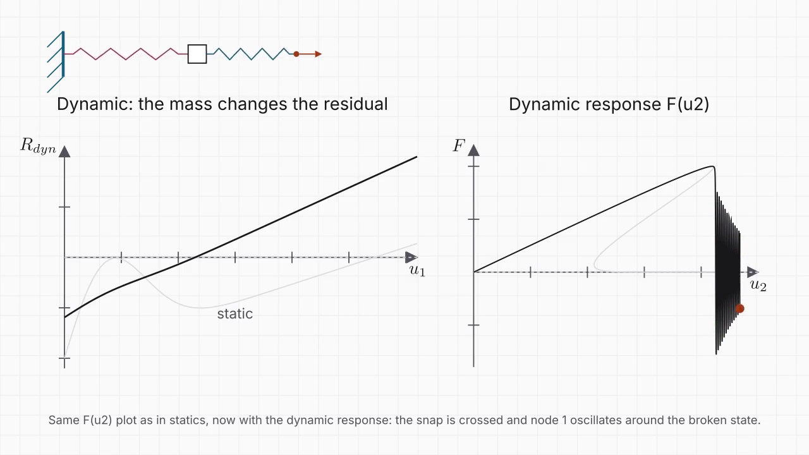

# 1D damage spring system

[](video/snapback_short.mp4)

*Short explainer (1 min 37, Manim): the equilibrium branch, why Newton-Raphson struggles at the limit point, and how inertia regularises the residual. File: `video/snapback_short.mp4`.*

This work is presented in a LinkedIn article: [Snap-back of a damageable spring](https://lnkd.in/p/eDt_BEs8).

Snap-back of a damageable spring in series with an elastic one: closed-form, static Newton-Raphson and dynamic Newmark solutions, with a comparison of the Newton-Raphson residuals.

One-degree-of-freedom 1D model: a concrete specimen (damageable spring, law `d = 1 - exp(-(u/uc)²)`) in series with an elastic steel bar, under displacement control. Since the bar stiffness is lower than the softening slope of the concrete, the force-displacement response shows a snap-back that quasi-static displacement control cannot follow. The code compares three solutions: the complete equilibrium branch in closed form, a plain static Newton-Raphson confronted with the limit point, and an implicit Newmark scheme that converts the released energy into kinetic energy. The figures show in particular how the inertia term regularises the non-monotonic Newton-Raphson residual, and compare the number of Newton-Raphson iterations per increment in statics (failure at the limit point) and in dynamics (a few iterations throughout).

## Layout

| File | Role |
|---|---|
| `parameters.py` | all physical and numerical parameters (static: `inc`, `eps_nr`, `max_iter`; dynamic: `beta_nm`, `gamma_nm`, `N_per_period`, `max_iter_dyn`, `v2`, `t_hold`), derived quantities (`python parameters.py` prints the summary) |
| `model.py` | damage law with history variable, static residual and tangent, Newton-Raphson |
| `analytical_solution.py` | equilibrium branch parametrised by `u1`, peak, energy balance of the jump |
| `static_solution.py` | `u2` increments, plain Newton-Raphson; at the limit point the NR either jumps by itself onto the damaged branch (coarse increments) or fails and the calculation stops (fine increments) |
| `dynamic_solution.py` | implicit predictor-corrector Newmark, ramp then hold of `u2` |
| `comparison.py` | assembles the three solutions and produces the figures |
| `export_data.py` | writes every computed curve to plain-text `.dat` files in `data/` (pgfplots `\addplot table`, Manim `numpy.loadtxt`) |
| `data/` | exported data: parameters, damage law, analytical branch, static and dynamic histories, residual curves, NR iterates, energies |
| `math_curve.py` | interactive matplotlib figure: damage law, `F1(u1)` with the line of slope `-k2`, analytical `F(u2)`, with a slider on `k2/k1` |
| `fig_snapback_raideurs.py` | figure of the snap-back criterion versus `k2/k1` (limit point, tangent of minimum slope) |
| `figures/` | figures produced by `comparison.py --save` |
| `video/` | short explainer video and its thumbnail |

## Usage

```bash
pip install numpy matplotlib
python comparison.py          # shows the figures
python comparison.py --save   # also saves them in figures/
python export_data.py         # writes the .dat files in data/
python math_curve.py          # interactive figure (slider on k2/k1)
```

Units: N, mm, s, tonne.
